# Lab 10: Lakehouse Federation & Change Data Capture

## Overview

This lab demonstrates two approaches to integrating an external operational database with Azure Databricks: **Lakehouse Federation** for querying live data and **Change Data Capture (CDC)** for incremental data processing.
The lab uses Microsoft's AdventureWorksLT sample database deployed in Azure SQL Database, containing operational sales, customer, and product data.

**Architecture:**

`Azure SQL (AdventureWorksLT) → Lakehouse Federation → Databricks SQL`

`Azure SQL CDC → Incremental MERGE → Delta Lake (SCD Type 2)`

The solution uses Azure SQL Database, Unity Catalog, Databricks SQL, Python, Delta Lake, and SQL Server CDC.

## Part A: Lakehouse Federation

An Azure SQL Database was connected to Databricks through a Unity Catalog connection and foreign catalog. Federated queries were tested for filtering, aggregation, and query pushdown.

A Delta snapshot of `SalesLT.SalesOrderHeader` was created to compare federation with ingested data. A cross-source JOIN between external customer data and Delta orders was also performed.

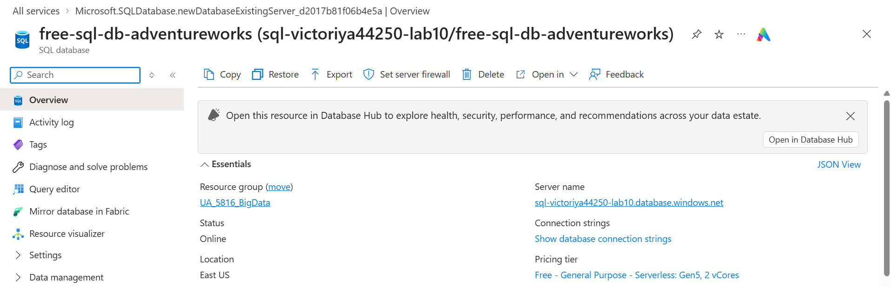
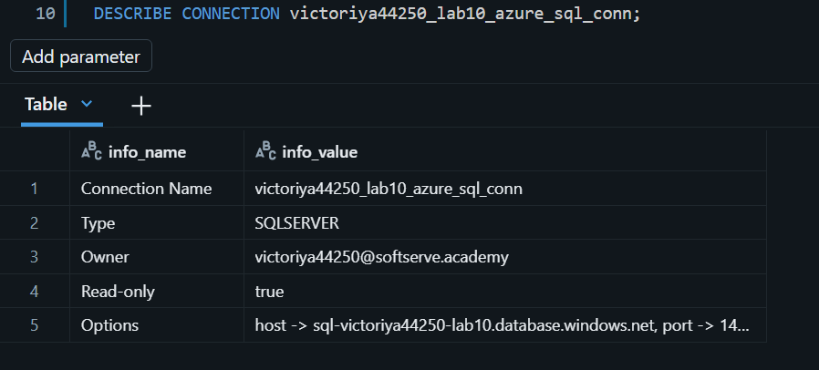
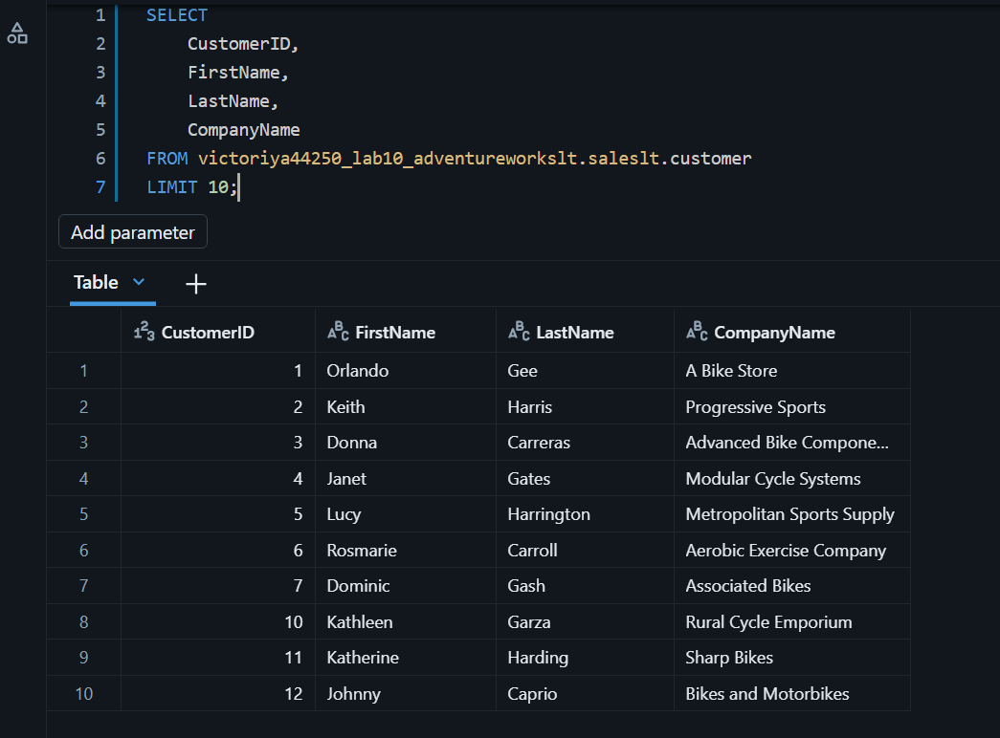

**Query execution analysis:** Filtering was pushed down to Azure SQL, while the tested aggregation was processed in Databricks.

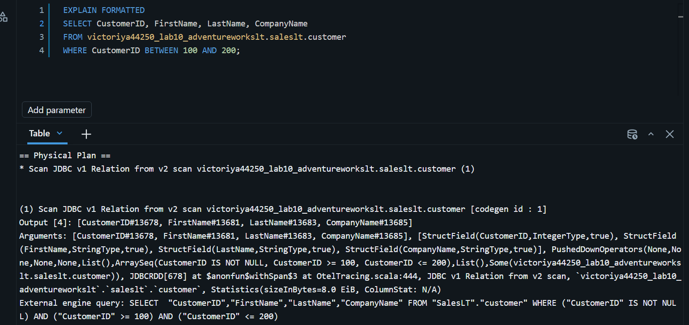
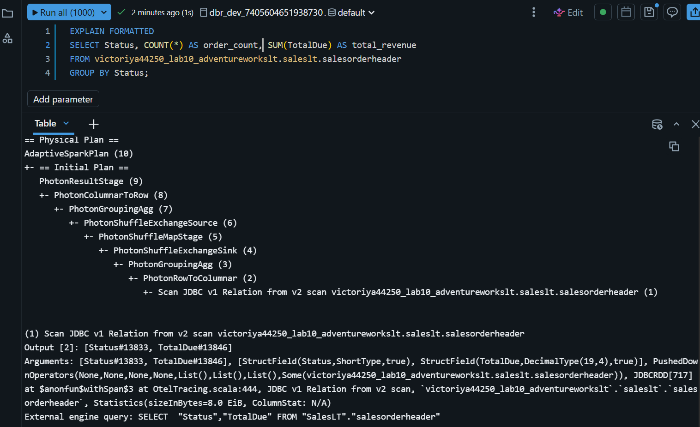

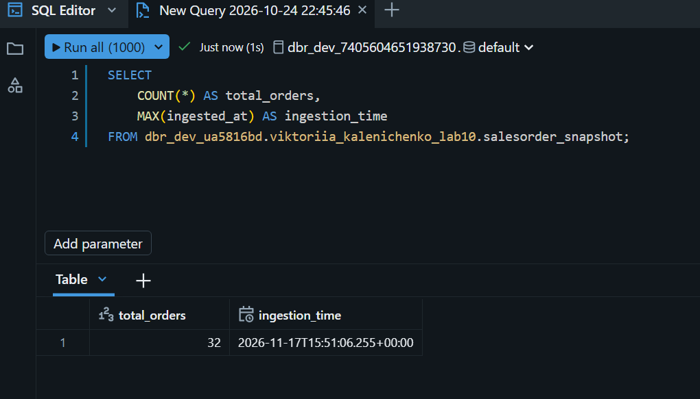
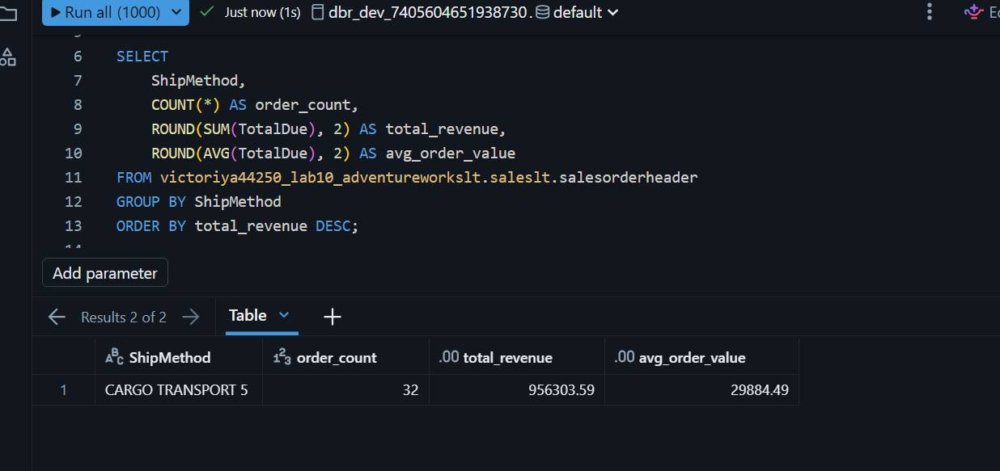
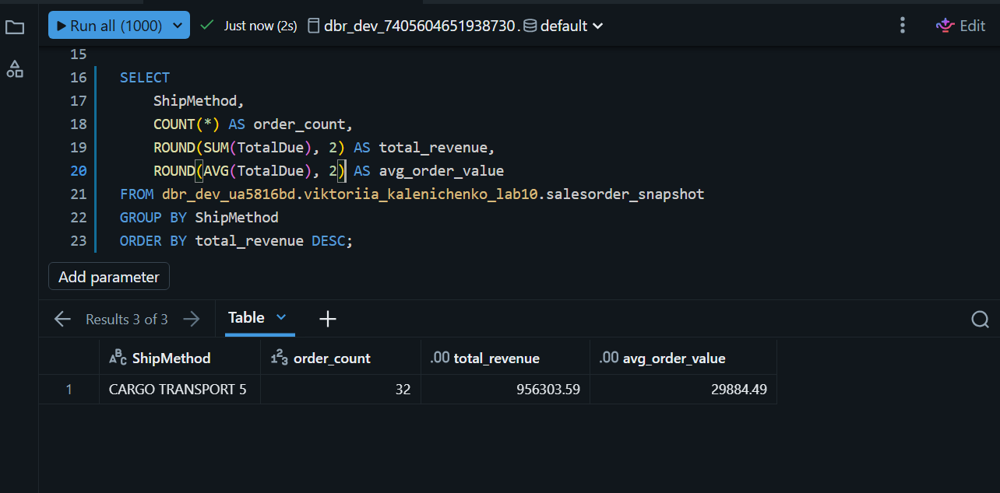
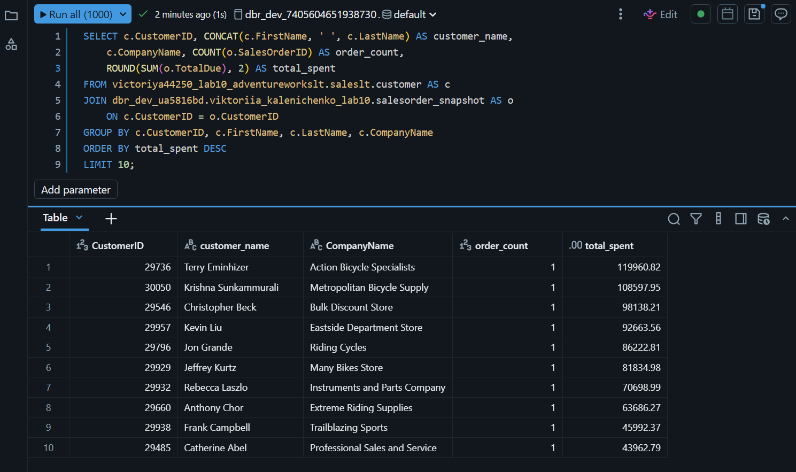

## Part B: CDC & SCD Type 2

SQL Server CDC was enabled for `SalesLT.Customer`, and **847 customer records** were initially loaded into a Delta SCD2 table. Incremental changes are identified using LSN-based watermark tracking and applied through `MERGE INTO`.

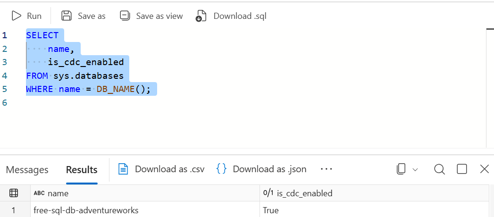
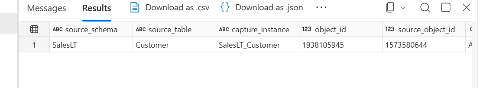
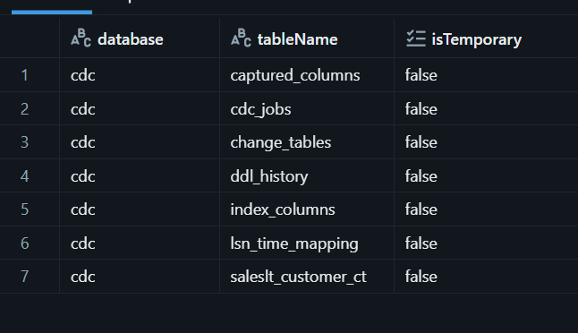
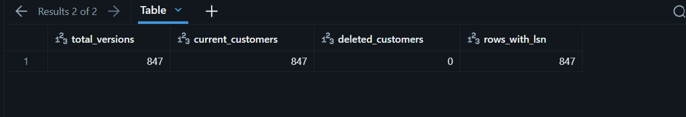

### Custom Customer Lifecycle Simulation

Instead of modifying existing AdventureWorks customers, three dedicated test customers were created to simulate realistic CRM operations:

| Customer | Simulated changes |
|---|---|
| Olivia Morgan | INSERT → company rebranding |
| Daniel Reed | INSERT → email update → phone update |
| Ethan Brooks | INSERT → DELETE |

An additional **no-op UPDATE** was tested to investigate CDC behavior when the business value remains unchanged; no additional events were observed during that test.

The incremental pipeline processed **7 CDC events affecting 3 customers**. SCD Type 2 preserved intermediate updates, closed outdated versions, and retained the history of the deleted customer.

### Results

| Metric | Result |
|---|---:|
| Total SCD2 versions | 853 |
| Current customers | 849 |
| Deleted historical versions | 1 |
| Repeated MERGE run | No additional versions |

**SCD2 history:** Olivia has 2 versions, Daniel has 3 versions, and Ethan has 1 closed, deleted version. This confirms that intermediate changes and deletions were preserved.

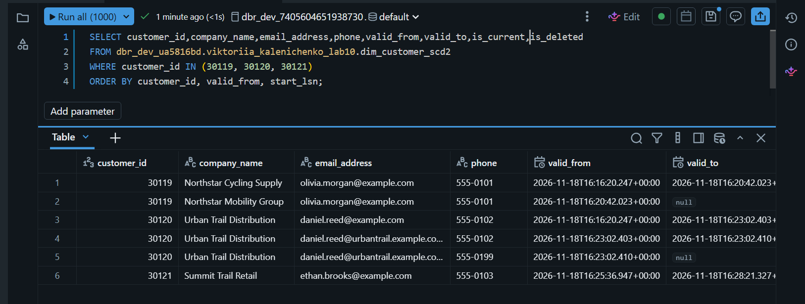
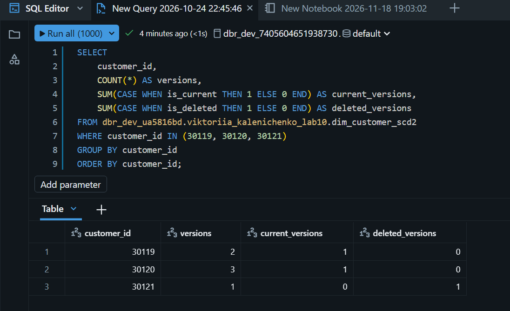

## Discussion & Conclusions

Federation vs Ingestion: Federation provides access to external data without copying it but depends on source availability, network latency, and access permissions. Delta ingestion supports local analytics and historical processing but requires data synchronization.

Batch vs CDC: Batch ingestion processes snapshots, whereas CDC captures incremental inserts, updates, and deletes, reducing unnecessary data movement.

SCD Type 2: Historical customer states are retained rather than overwritten. LSN ordering helps process changes in source transaction order, including delayed CDC events. The pipeline must also account for CDC retention limits and interruptions.

Conclusion: The lab successfully combined live Azure SQL queries with incremental CDC processing in Databricks. The custom customer lifecycle tests demonstrated accurate historical tracking, correct delete handling, and idempotent MERGE execution.