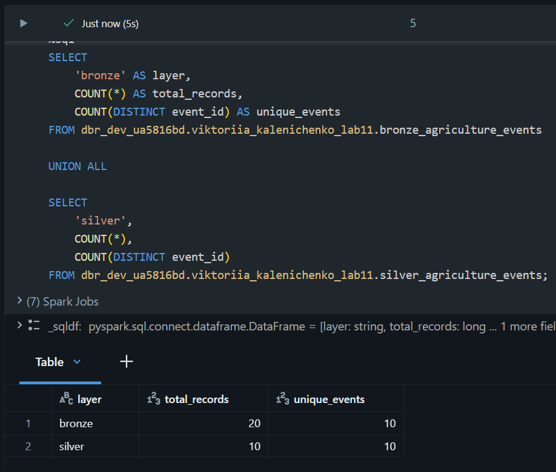
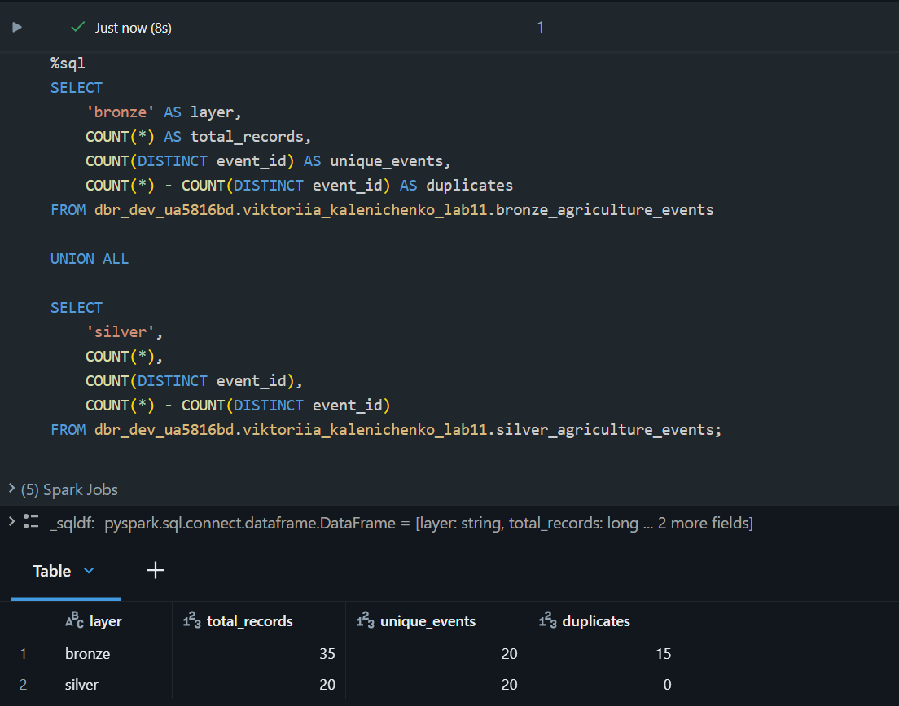
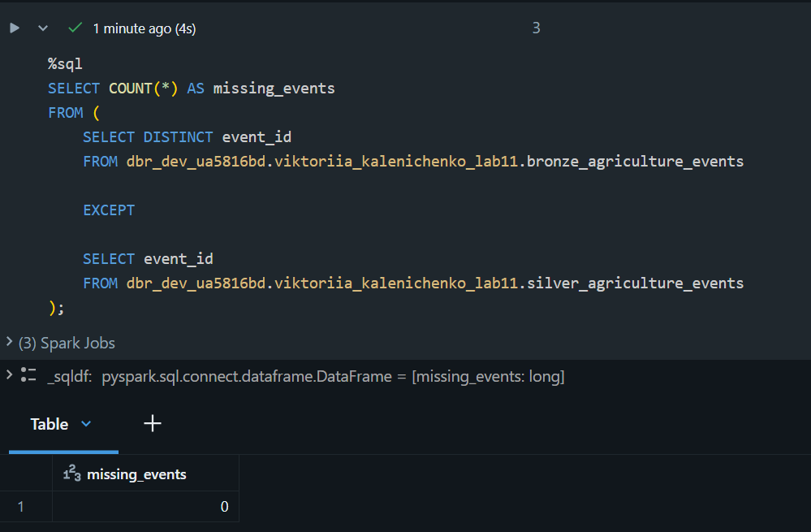

# Lab 11: Zerobus agricultural Data Streaming

## Overview

This lab implements event-driven ingestion into Azure Databricks using **Zerobus Ingest**, without an intermediate message broker.

The producer replays historical agricultural data from `europe_cereal_yield_climate_1990_2022.csv` (Lab 8) as a simulated event stream.

**Architecture:**

`Agricultural CSV → Python Producer → Zerobus Ingest → Bronze Delta → Silver Delta`

## Implementation

- **Producer:** Python application using Zerobus SDK and OAuth service principal authentication. Sends agricultural records directly to a Unity Catalog Delta table.
- **Bronze:** Stores all received events, including duplicate deliveries.
- **Silver:** Uses Structured Streaming, `ROW_NUMBER()` and an insert-only `MERGE INTO` to keep one record per `event_id`.
- **Checkpoint:** Tracks processed Bronze data for incremental execution.

The producer runs locally, while Bronze-to-Silver processing runs in Databricks.

## Idempotency Validation

Repeated events retain their original `event_id`, allowing duplicates to be identified and excluded from Silver.

| Test stage | Bronze records | Silver records |
|---|---:|---:|
| Initial ingestion and duplicate replay | 20 | 10 |
| 10 new events processed | 30 | 20 |
| 5 previously processed events resent | 35 | 20 |

**Final validation:**

| Metric | Bronze | Silver |
|---|---:|---:|
| Total records | 35 | 20 |
| Unique events | 20 | 20 |
| Duplicates | 15 | 0 |

Reconciliation confirmed **0 missing events** in Silver.

## Kafka-Style vs Zerobus

The Kafka-style architecture was previously implemented in Lab 3 using Azure Event Hubs.

| Aspect | Kafka-style (Lab 3) | Zerobus (Lab 11) |
|---|---|---|
| Data flow | Producer → Event Hubs → Spark consumer → Delta | Producer → Zerobus → Delta |
| Message broker | Required | Not required |
| Multiple consumers | Supported | Lakehouse as primary destination |
| Replay | Event Hub retention and offsets | From retained Delta data |
| Operational overhead | Broker and consumer management | Managed serverless ingestion |
| Cost considerations | Event Hub and consumer compute | Usage-based ingestion and downstream compute |

**Discussion:** Kafka-style architectures provide stronger producer-consumer decoupling and support multiple independent consumers. Zerobus simplifies ingestion when the lakehouse is the primary destination, reducing infrastructure and maintenance requirements. Both approaches require appropriate handling of duplicate events.

## Results

The producer successfully pushed agricultural events into a Unity Catalog Delta table through Zerobus. Incremental Bronze-to-Silver processing preserved all 20 unique events and prevented duplicate inserts across repeated runs.

## Conclusion

Zerobus successfully delivered agricultural events directly to Delta Lake without a message bus. The Silver pipeline demonstrated idempotent processing, with **0 duplicates and 0 missing events** in the tested scenario.