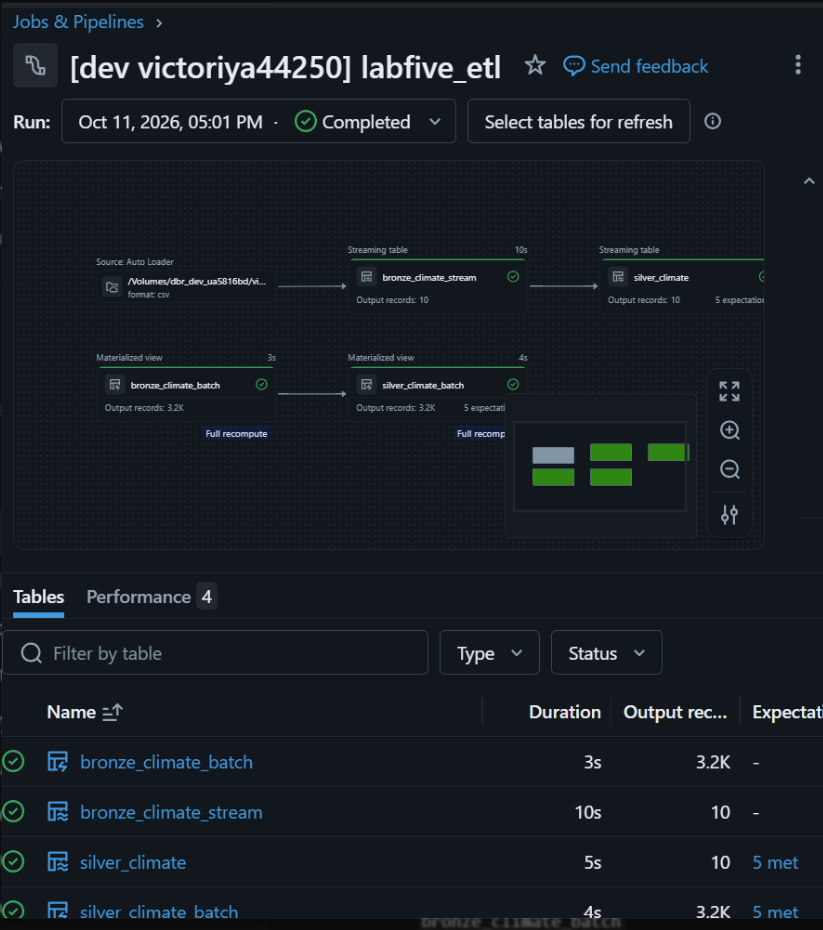
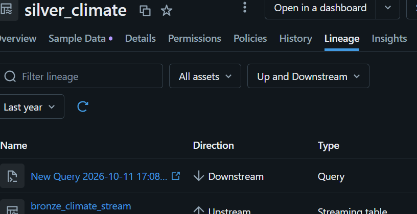
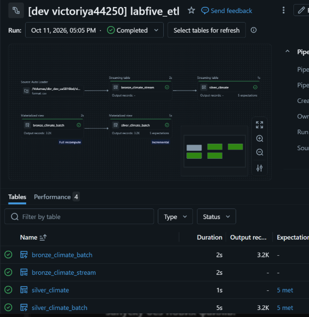
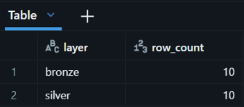
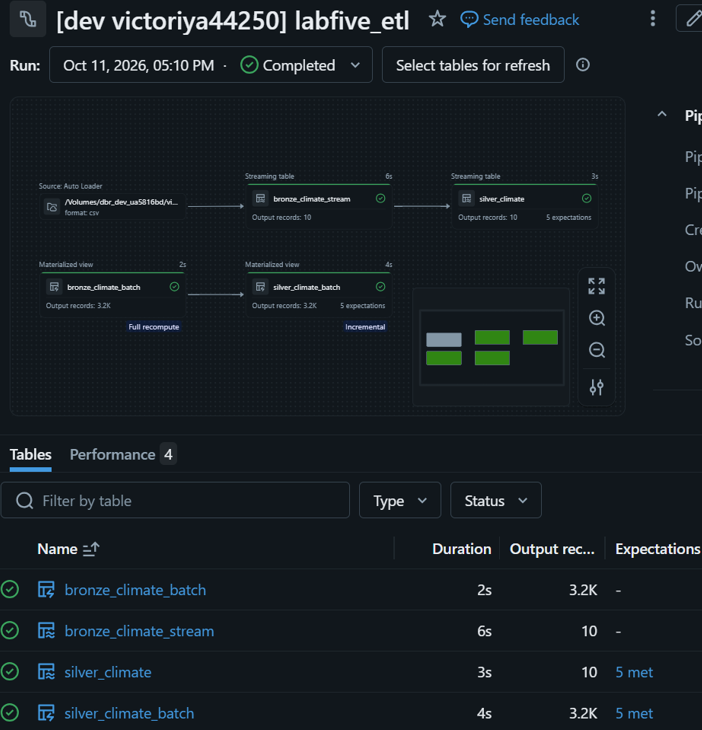
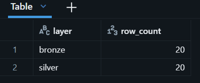

# Lab 5 — Lakeflow Spark Declarative Pipelines

## Goal
Compare Lakeflow Spark Declarative Pipelines with classic Spark pipelines implemented in Lab 4.
This project implements batch and streaming data ingestion, Bronze-to-Silver transformations, data quality expectations and deployment using Databricks Asset Bundles.

## Architecture
### Streaming pipeline
CSV files in Unity Catalog Volume -> Auto Loader -> bronze_climate_stream -> silver_climate

### Batch pipeline
CSV file in Unity Catalog Volume → Spark batch reader -> bronze_climate_batch -> silver_climate_batch

The pipelines use the existing Unity Catalog and separate Bronze and Silver schemas. New Lab 5 tables are created without modifying existing Lab 4 tables.

## Data Quality Expectations
Both Silver datasets include the following rules:

| Expectation | Rule | Action |
|---|---|---|
| `valid_area` | AREA is not NULL or empty | Drop invalid rows |
| `valid_item` | ITEM is not NULL or empty | Drop invalid rows |
| `valid_year` | YEAR is between 1990 and 2022 | Drop invalid rows |
| `valid_yield` | YIELD is NULL or non-negative | Drop invalid rows |
| `valid_production` | PRODUCTION_QUANTITY is NULL or non-negative | Drop invalid rows |

Expectations are implemented using `@dp.expect_or_drop`.

## Classic Spark vs Declarative Pipelines

- Pipeline logic: In Lab 4 we wrote each step ourselves. In Lab 5 we define tables and how to create them.
- Execution: Classic Spark uses notebook jobs. Lakeflow manages the pipeline automatically.
- Data quality: In Lab 4 we wrote our own checks. In Lab 5 we use built-in expectations.
- Streaming: Lakeflow makes it easier to process new data.
- Maintenance: In Lab 4 we used OPTIMIZE and VACUUM ourselves. Lakeflow handles more maintenance tasks automatically.
- Flexibility: Classic Spark gives us more control. Lakeflow is easier to use but has some limits.
- Deployment: Both can use Databricks Asset Bundles to move code between workspaces.

**Conclusion:** Classic Spark gives us more control, but we need to write and manage more code. Lakeflow makes building and managing pipelines easier.

## Deployment

The pipeline is configured through `databricks.yml` and `resources/labfive_etl.pipeline.yml`.

## Results

### 1. Pipeline Execution
- Completed successfully.
- All 5 expectations met in both Silver tables.

### 2. Data Lineage
- Bronze -> Silver lineage verified.

### 3. Safe Reload
- No new files: 10 -> 10 rows.
- No new rows or duplicates after the second run.

### 4. Incremental Loading
- Added a second CSV file.
- Bronze and Silver: 10 -> 20 rows.

