# Lab 6: Gold Layer, Analytics and Governance

## Overview

In this lab, I built a Gold data layer for European agriculture and environmental analysis using Databricks and Unity Catalog.

The project includes a Star Schema, aggregate tables, an AI/BI Dashboard, a Genie Agent, a data volume alert and data governance.

## 1. Data Migration

The original Silver tables were stored in another DB workspace.

To continue the project in a new trial workspace: I exported three silver tables as parquet files; uploaded the parquet files to a Unity Catalog Volume; used PySpark to read the files and create managed delta tables; checked the restored data before building the gold layer.

The migrated tables were `yield_and_climate`, `environment`, and `scd1`.

See the `data_migration/` folder.

## 2. Gold Layer and Star Schema

I created a Star Schema with three dimension tables and one fact table:

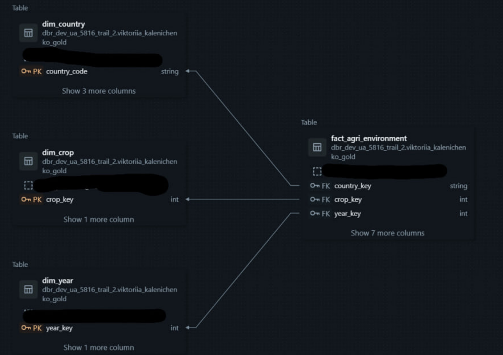

I also created two aggregate tables:

- `agg_crop_year`: 99 records.
- `agg_country_year`: 1,146 records.

The dataset covers selected European countries.

See the `sql/` folder.

## 3. AI/BI Dashboard

I created and published the **European Agriculture & Environment Analytics** dashboard. It includes KPI cards, crop production trends, country comparisons and environmental indicators. Users can explore the data using filters.

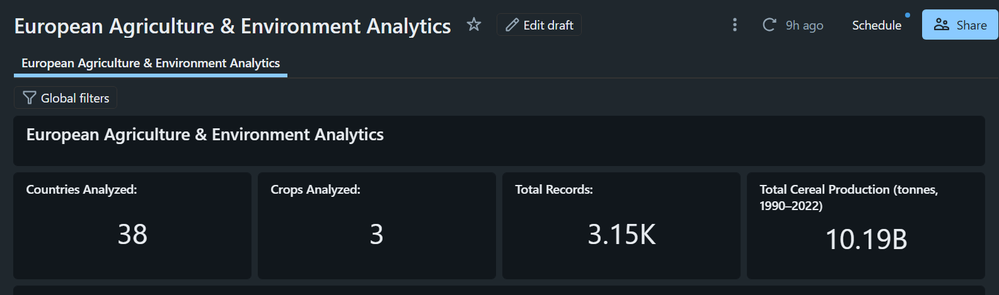

**Crop Production Trends  (1990–2022)**

Wheat had the highest production throughout the studied period. Maize production increased significantly over time, while barley remained relatively stable.

Filters: Use the year filter to focus on a shorter period, if it is connected to this chart.

**Total Production by Crop (1990–2022)**

This chart compares the total production of each crop over the full period. Wheat accounts for the largest share of total cereal production.

Filters: A year filter can be used to compare crop production during selected years.

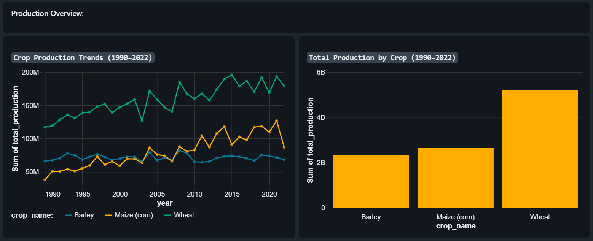

**Country Comparison**

This chart shows the differences in agricultural production between European countries. France, Ukraine, and Germany have the highest total production across the selected crops during 1990–2022.

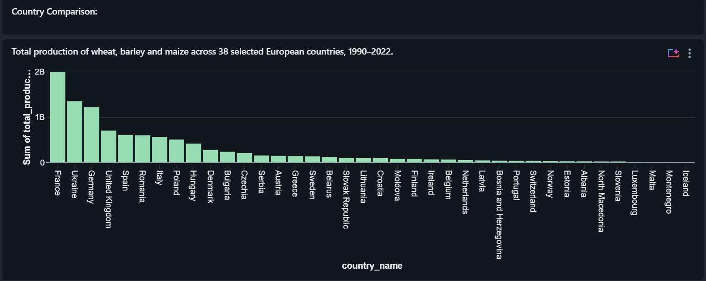

**Top 10 European Countries by Cereal Production (2018–2022)**

This chart shows the ten countries with the highest total production of wheat, barley, and maize from 2018 to 2022.

Ukraine ranks first, followed by France and Germany. The chart makes it easier to compare the leading agricultural producers.
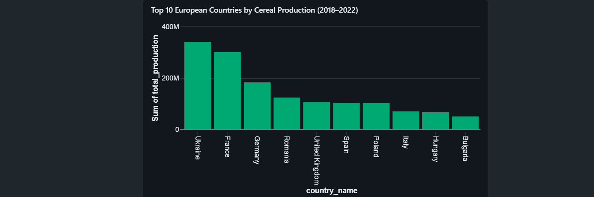

**Agricultural Production Map (2022)**

The map shows how agricultural production differs across European countries in 2022. 

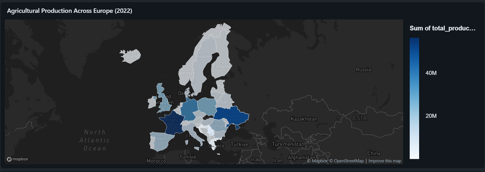

**Forest Area Trends by Country (1990–2022)**

This chart compares forest area indicators across European countries over time. Forest area values differ significantly between countries. Many countries show gradual changes rather than large year-to-year fluctuations.

The chart includes many lines, so the country filter is useful for focusing on a specific country.

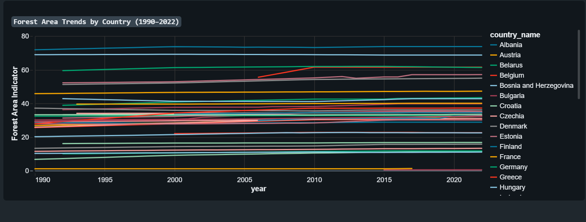

This screenshot demonstrates the country filter applied to the forest area chart.

After selecting Ukraine, the dashboard displays only its forest area trend. The indicator increases from approximately 16.1 in the early 1990s to 16.7 in 2022.

This example shows how dashboard filters make detailed analysis easier.

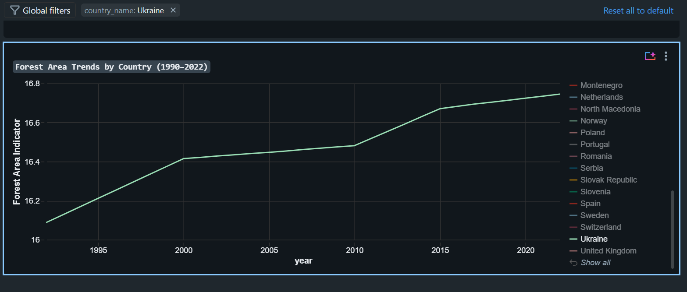
## 4. Genie Agent

I created the **Agricultural Production and Environment** Genie Agent using Gold-layer tables.
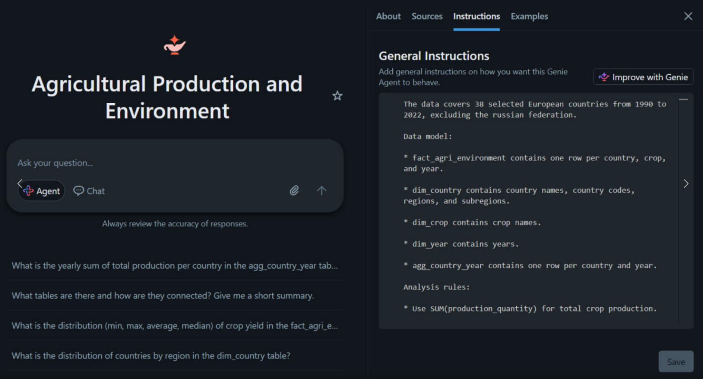
The agent can answer natural-language questions about agricultural production and environmental indicators.

I tested it with a question about wheat production in 2022.

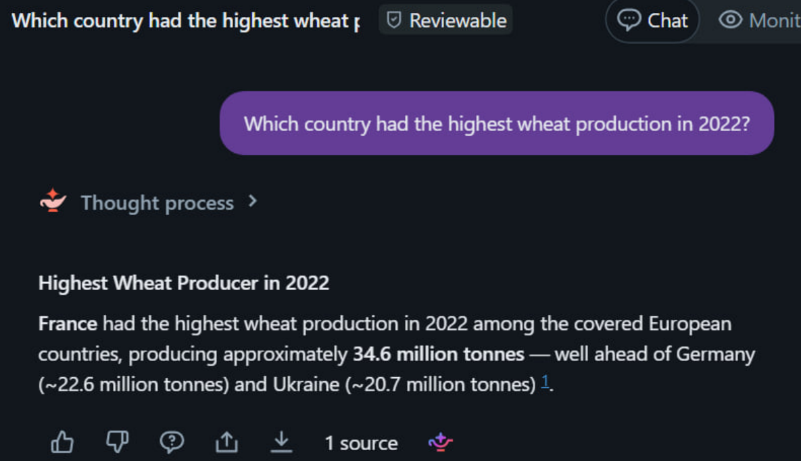

## 5. Data Volume Alert

I created a test Delta table and configured a Databricks SQL Alert to detect a drop in data volume.

The alert condition was:

`row_count < 80`

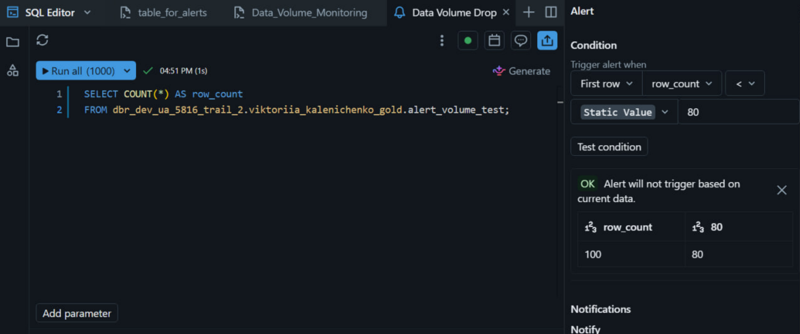
I simulated a decrease to 50 rows and verified that the alert triggered successfully.
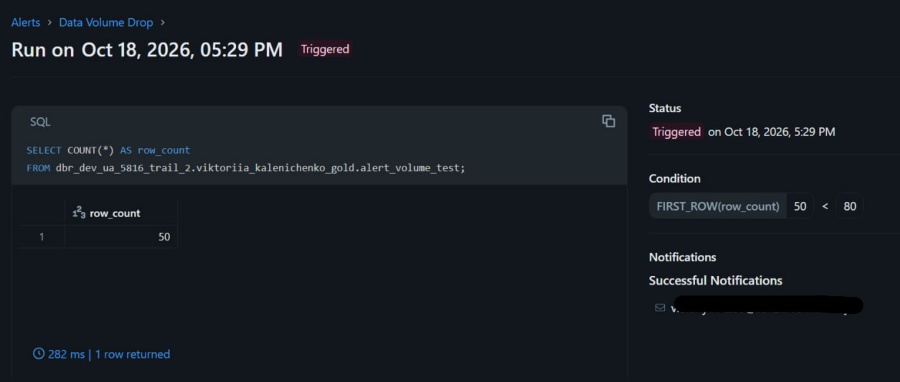

## 6. Data Governance

I demonstrated GRANT SELECT permissions and implemented RLS and CLS using three access roles:

 - **admin**: all rows and full production values.
 - **analyst**: all rows, but production values are masked. 
 - **regional_viewer**: only the assigned subregion, with masked production values.

The test role is selected using Databricks widgets.

Role switching was performed for demonstration purposes. In a production environment, users must not be allowed to change their own roles.

See the `governance/` folder.

### Governance Role Tests

**Admin:**
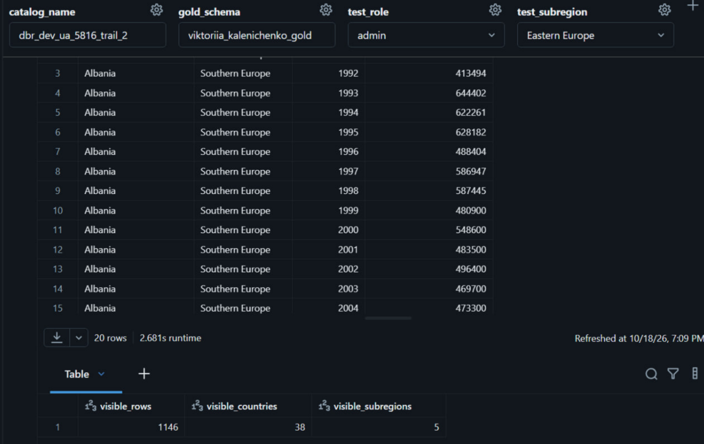
**Analyst:**
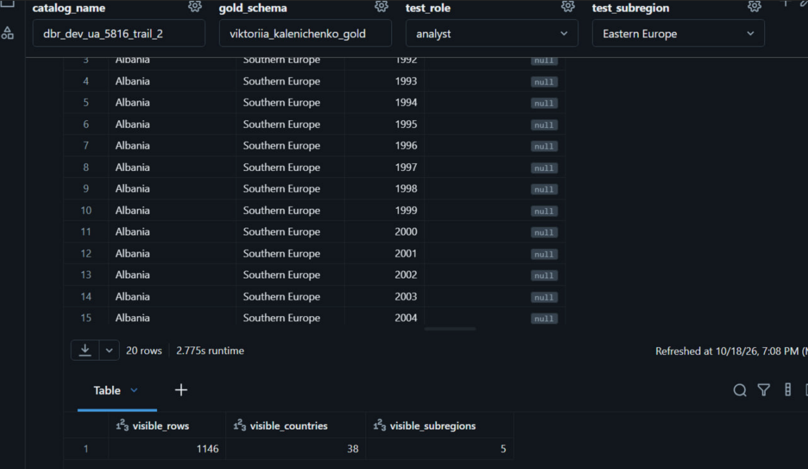
**Regional_viewer**
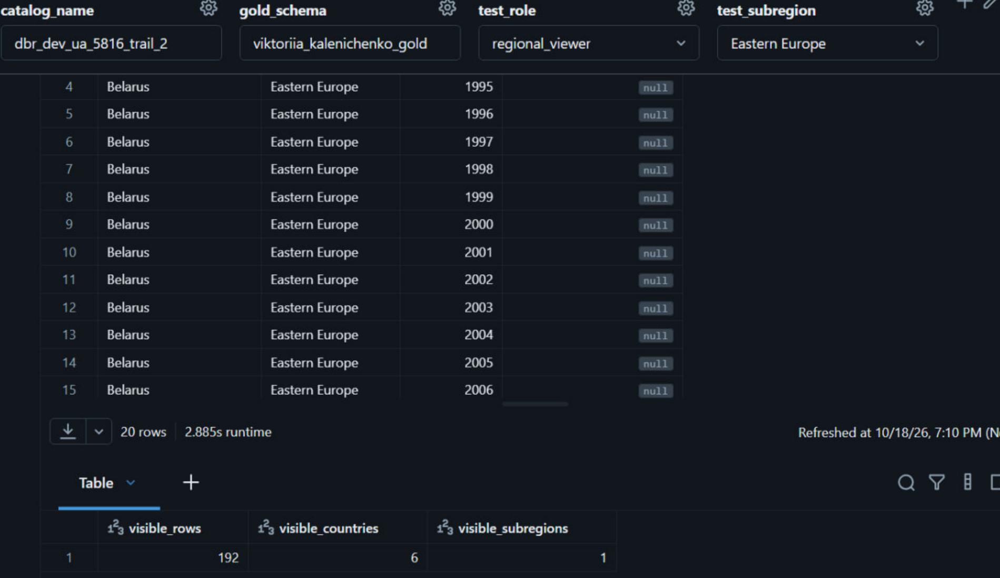

## Result

The Gold layer was created and validated, the dashboard and Genie Agent were tested, the data volume alert was triggered and the governance policies were applied and demonstrated.