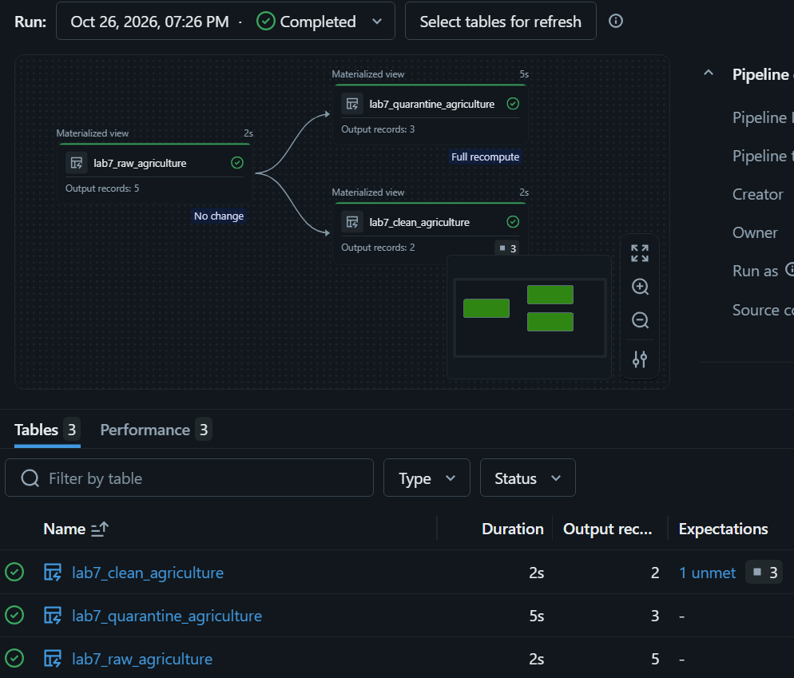

# Lab 7 — Unit Testing & Data Quality

## Overview

Unit testing and data quality validation for the Databricks Bronze–Silver–Gold architecture.

## Implementation

- Reusable PySpark transformations and data quality functions
- Unit tests using `pytest` and Databricks Connect
- Data quality checks: completeness, uniqueness, validity, consistency, and reconciliation
- Lakeflow expectations and quarantine for invalid records
- Delta Lake `NOT NULL` and `CHECK` constraints
- Databricks Asset Bundle for automated DQ job execution

## Results

- **18/18 unit tests passed** locally
- **20/20 data quality checks passed** in Databricks
- Databricks DQ Job completed successfully
- Invalid sample records were quarantined or rejected by constraints

## Run Tests

Set `DATABRICKS_CONFIG_PROFILE` to a configured Databricks profile and run:

```bash
python -m pytest -q tests
```
## Project organization and execution

- `src/` contains reusable functions; `tests/` contains 18 unit tests.
- `pipelines/` contains the Lakeflow expectations and quarantine demo.
- `demos/` contains the Delta constraints notebook with saved test results.
- Root-level `run_*` files are entry points kept beside `src/` and `tests/`.

### Why two databricks.yml files?

Both configurations support headless execution: running Jobs through the CLI
without manually executing notebook cells.

- Root `databricks.yml` defines the DQ Job with 20 data-quality checks.
- `headless/databricks.yml` defines a separate Job running all 18 unit tests.

The bundles are separate to preserve the existing DQ deployment.
Run CLI commands from the folder containing the intended configuration.


## CI/CD

GitHub Actions automatically runs **7 tests without Spark**. The remaining **11 Spark-dependent tests** run locally via Databricks Connect.

Workflow: `.github/workflows/lab7-tests.yml` (repository root)

## Screenshots

### Data Quality — 20 checks passed


### GitHub Actions — successful CI run


## Additional data quality evidence

- [Lakeflow expectations and quarantine](pipelines/lab7_agriculture_pipeline.py):
  5 sample records split into 2 valid and 3 quarantined records,
  with rejection reasons.
  
  
- [Delta constraints and negative tests](demos/delta_constraints_demo.ipynb):
  NOT NULL and CHECK constraints reject invalid inserts;
  a valid insert succeeds. Saved errors are expected negative-test results.