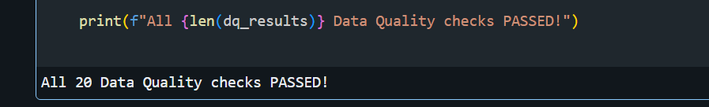
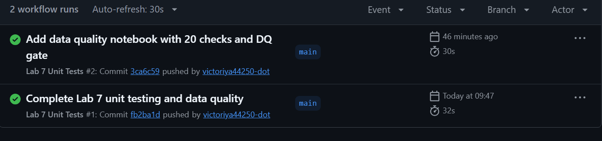

# Lab 7 — Unit Testing & Data Quality

## Overview

Unit testing and data quality validation for the Databricks Bronze–Silver–Gold architecture.

## Implementation

- Reusable PySpark transformations and data quality functions
- Unit tests using `pytest` and Databricks Connect
- Data quality checks: completeness, uniqueness, validity, consistency, and reconciliation
- Lakeflow expectations and quarantine for invalid records
- Delta Lake `NOT NULL` and `CHECK` constraints
- Databricks Asset Bundle for automated DQ job execution

## Results

- **18/18 unit tests passed** locally
- **20/20 data quality checks passed** in Databricks
- Databricks DQ Job completed successfully
- Invalid sample records were quarantined or rejected by constraints

## Run Tests

Set `DATABRICKS_CONFIG_PROFILE` to a configured Databricks profile and run:

```bash
python -m pytest -q tests
```

## CI/CD

GitHub Actions automatically runs **7 tests without Spark**. The remaining **11 Spark-dependent tests** run locally via Databricks Connect.

Workflow: `.github/workflows/lab7-tests.yml` (repository root)

## Screenshots

### Data Quality — 20 checks passed


### GitHub Actions — successful CI run
