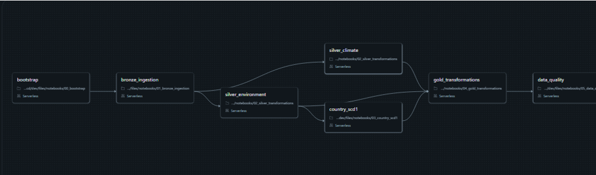

# Lab 8 — CI/CD: DEV → PROD Promotion

This project promotes the European Agriculture & Environment Analytics workload from a Databricks Free Edition DEV workspace to an Azure Databricks PROD workspace using a Databricks Asset Bundle and GitHub Actions.

## What is deployed

- `databricks.yml` defines `dev` and `prod` targets and the seven-task `lab8_pipeline` job.
- `notebooks/00_bootstrap.ipynb` through `05_data_quality.ipynb` load the bundled CSV files, build Bronze, Silver and Gold tables, and check data quality. Table creation and transformations are versioned in the notebooks.
- `dashboards/european_agriculture.lvdash.json` contains the dashboard pages, visualizations, filters and six SQL datasets. The Bundle points the dashboard to the PROD Gold catalog and schema.
- The PROD target declares the Bronze, Silver and Gold schemas, managed volumes, dashboard, job and the deployment owner's `CAN_MANAGE` permission. The DEV target uses existing DEV workspace resources.

## CI/CD flow

The workflow is in [`.github/workflows/lab8-ci-cd.yml`](../.github/workflows/lab8-ci-cd.yml).

| Event | GitHub Actions behavior |
| --- | --- |
| Pull request to `main` | Run unit tests and `databricks bundle validate -t prod`. |
| Merge to `main` | Run unit tests and validation, then `databricks bundle deploy -t prod`. |
| Manual workflow dispatch | Run tests, validation and a PROD deployment plan. |

The workflow reads `DATABRICKS_HOST` and `DATABRICKS_TOKEN` from GitHub Actions secrets. Their values are not stored in the repository. The PROD data-processing job is not run automatically on every merge, to avoid unnecessary paid compute.

## Production job orchestration

## Verification

- [PR #4](https://github.com/victoriya44250-dot/databricks/pull/4) passed both PR checks: unit tests and the Databricks CLI PROD Bundle validation.
- [GitHub Actions run after the merge](https://github.com/victoriya44250-dot/databricks/actions/runs/42858764558) passed unit tests, validation and automated PROD deployment. Its deployment log reports two permission resources created, no resources changed or deleted, and seven resources unchanged.
- A subsequent local `databricks bundle plan -t prod` reported **0 to add, 0 to change, 0 to delete, 9 unchanged**.
- The [PROD dashboard](https://adb-7405604651938730.10.azuredatabricks.net/dashboardsv3/01f1dd1ac5d613bf99c2521d1ae5cb31/published) displayed data. The deployed [PROD job](https://adb-7405604651938730.10.azuredatabricks.net/jobs/508729296912569) had a successful run confirmed in the workspace.

## Scope notes

The data flow is implemented as tasks in a Databricks Job rather than as a separate Lakeflow Pipeline resource. DEV schemas and volumes are pre-existing; PROD schemas and volumes are managed by the Bundle. 

The PROD token is used for PR validation as well as deployment. 

The dashboard was exported from a trial Azure Databricks workspace as `.lvdash.json`, preserving its pages, visualizations, filters, and six SQL datasets. Old catalog references were removed from the queries; the PROD catalog and Gold schema are set in the Bundle. Deployment created a new dashboard in PROD using the existing SQL Warehouse. Its data comes from the Gold tables built by the notebooks. We verified the required tables and confirmed that the dashboard displays data.