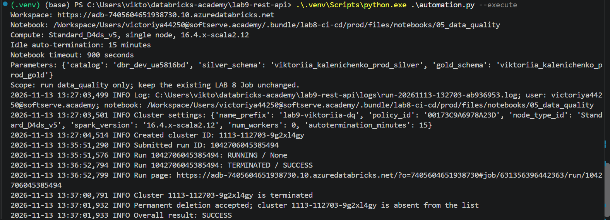
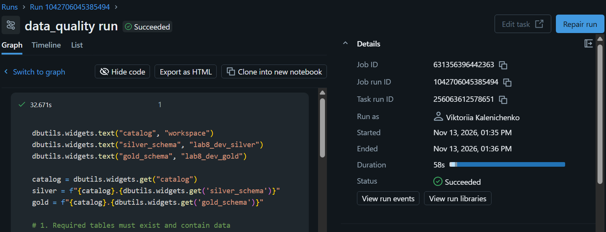
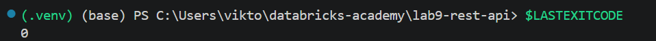
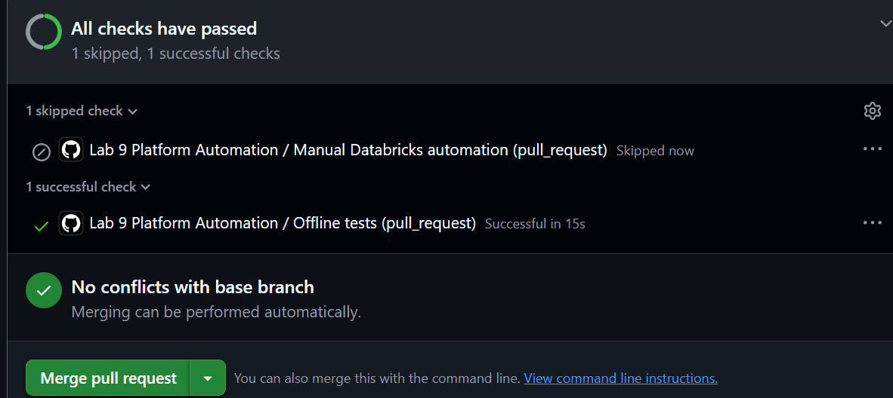
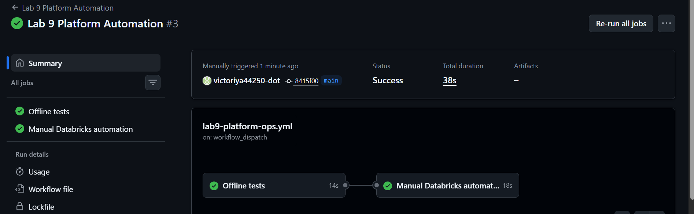
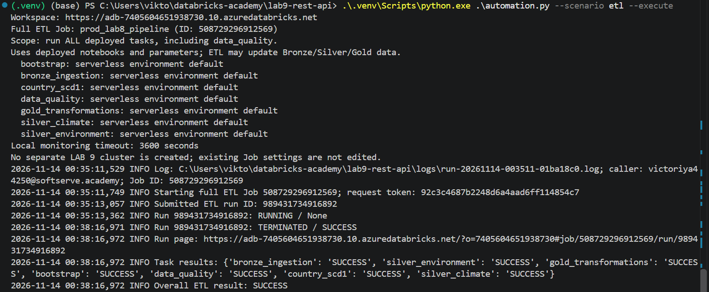
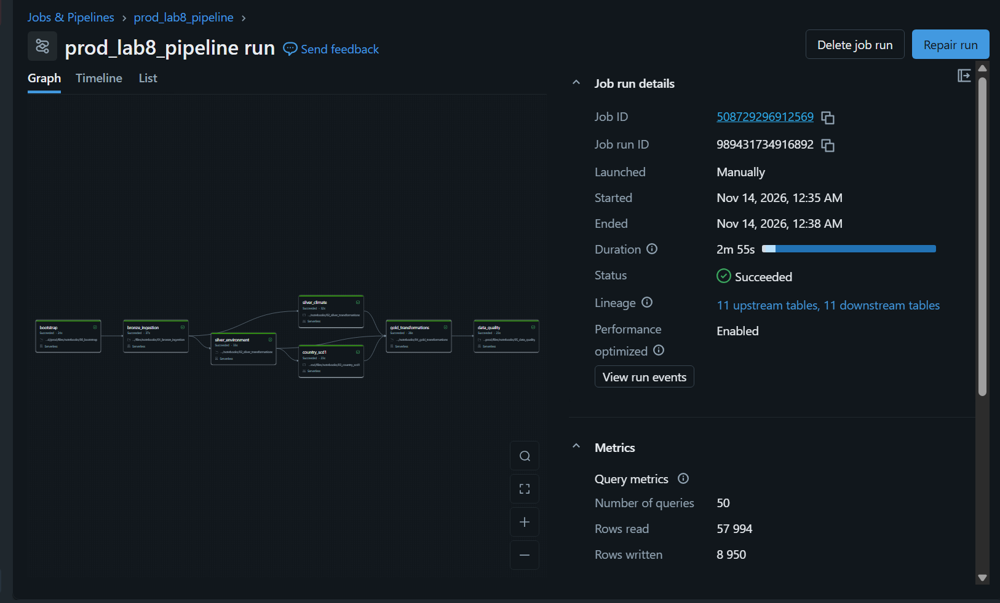

# LAB 9: Databricks REST API Automation

The Python SDK supports two scenarios:
- `dq` (default): runs the LAB 8 data-quality notebook on a temporary single-node
  cluster, monitors its result and attempts cluster cleanup in `finally`.
- `etl`: triggers the full deployed `prod_lab8_pipeline` Job, monitors its run
  and requires all seven tasks to succeed. It uses the Job's existing compute settings.

## Files

```text
lab9-rest-api/
├── automation.py             # entry point and end-to-end sequence
├── config.yml                # Workspace, Job, notebook and compute settings
├── requirements.txt          # Python dependencies
├── platform_ops/
│   ├── __init__.py           # marks the directory as a Python package
│   ├── settings.py           # load settings and check metadata
│   ├── compute.py            # create and remove the temporary cluster
│   ├── etl.py                # trigger and monitor the full LAB 8 Job
│   └── runs.py               # submit, monitor and cancel notebook runs
├── scripts/
│   ├── check_connection.py   # early connection-check exercise
│   └── preflight.py          # early Job/notebook discovery exercise
├── tests/
│   └── test_automation.py    # offline tests using mocked API responses
├── screenshots/              # evidence from real execution
└── logs/                     # created by the execution; ignored by Git
```

`.venv/` is the local Python environment and is also ignored by Git.

## Run from the lab9-rest-api directory

Install dependencies if needed:

```powershell
.\.venv\Scripts\python.exe -m pip install -r requirements.txt
```

Run offline tests (no Databricks calls or compute):

```powershell
.\.venv\Scripts\python.exe -m pytest -q tests
```

Preview the plan (reads Databricks metadata, does not start compute):

```powershell
.\.venv\Scripts\python.exe .\automation.py --plan
```

The default without flags is also preview only. `--execute` enables compute
and must only be used after the separate execution confirmation.

Preview the full ETL without starting it:

```powershell
.\.venv\Scripts\python.exe .\automation.py --scenario etl --plan
```

After explicit approval, replace `--plan` with `--execute` to run all seven tasks.
This uses deployed notebooks (not local uncommitted edits) and can update
Bronze/Silver/Gold data. A one-hour local deadline triggers cancellation of this
run; keep the process running until it finishes. Forced termination can prevent
cancellation. The script does not delete compute owned by the existing Job.

GitHub Actions uses the LAB 8 authentication secrets. PRs/pushes run offline tests;
manual runs on `main` offer `scenario: dq/etl` and `mode: plan/execute` (default: plan).


The early diagnostic exercises are optional, not prerequisites for every run:

```powershell
.\.venv\Scripts\python.exe .\scripts\check_connection.py
.\.venv\Scripts\python.exe .\scripts\preflight.py
```

## Understanding the code

Start with `execute()` in `automation.py`: request a cluster, save its ID, wait
for readiness, submit a notebook, save its run ID, monitor, then clean up.
`main()` reads command arguments and defaults to preview mode. Imports such as
`from platform_ops.compute import request_cluster` refer to our local helper files.
Moving a file into a folder changes its import path; the imports have been updated.
The diagnostic `preflight.py` now locates `config.yml` one directory above itself.

In `dq`, only a `SUCCESS` notebook result plus successful cleanup yields exit code 0.
In `etl`, the run and every expected task must report `SUCCESS` for exit code 0.
Failures return 1. Executions write IDs and status changes to `logs/`.
Forced process termination can prevent `finally` from finishing. Auto-termination
after 15 idle minutes and the notebook timeout are fallback limits, not a guarantee
that cleanup can finish after a crash. If the API creates a cluster but its response
is lost, inspect Compute for `lab9-viktoriia-dq` resources before retrying.

## Execution evidence













